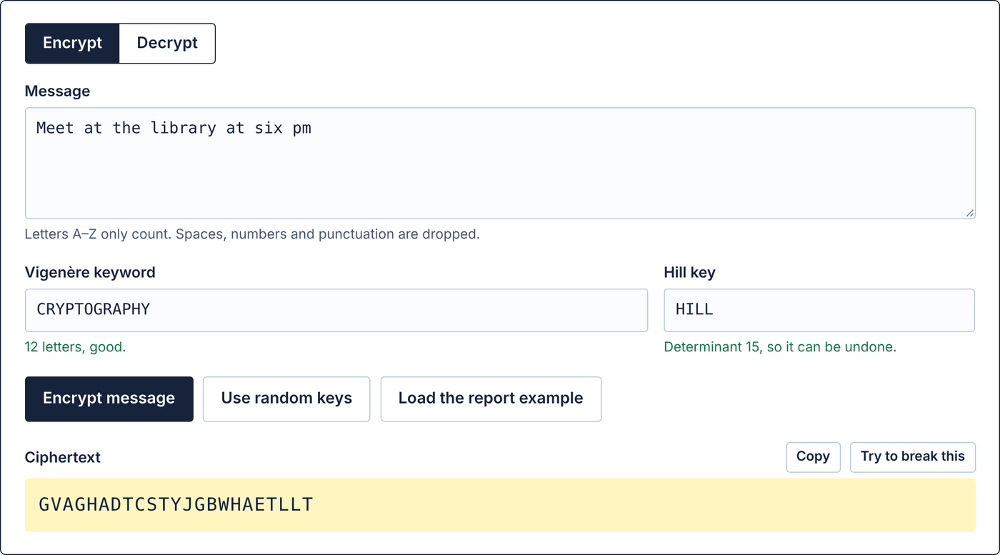
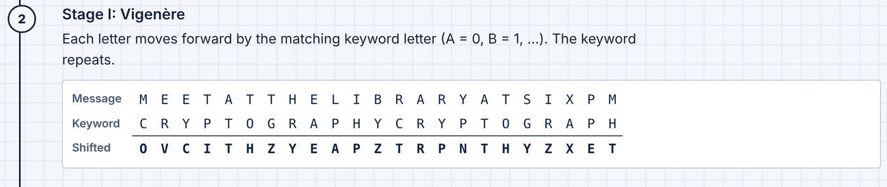
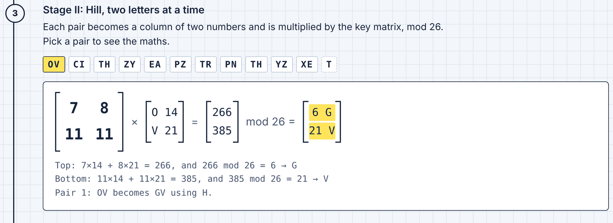
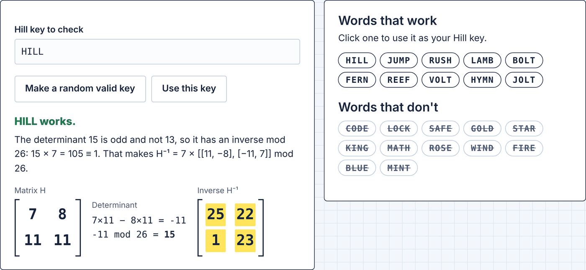
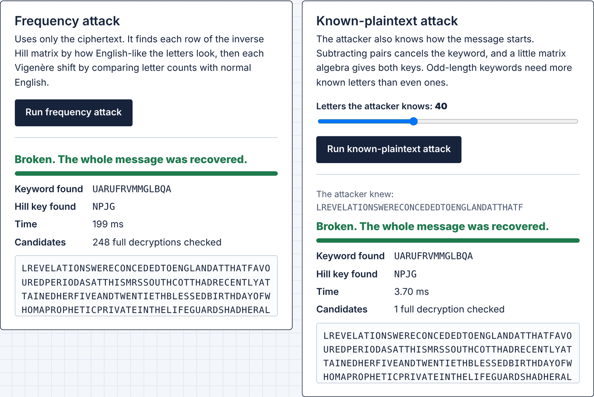

# VHC — Design and Break a Custom Cipher

**Course:** Network and Information Security (CT-486)  
**Assessment:** Complex Computing Problem, CLO3, Fall 2026  
**Group members:** Hamza Saleem (CR-23009), M Imaad Tahir (CR-23014), Mesum Raza (CR-23032), Waleed Kashif (CR-23040), M Owais Azhar (CR-23301)  
**Submitted to:** Prof. Dr. Shariq Mahmood Khan, Department of CS & IT, NED University of Engineering & Technology  
**GitHub:** https://github.com/HamzaSaleem56/NIS_CCP (public)  
**Try it online:** https://hamzasaleem56.github.io/NIS_CCP/ (no install needed)  
**License:** [MIT](LICENSE)

VHC (Vigenère–Hill Cascade) is a two-stage classical cipher built from two ciphers covered in the course (Vigenère and Hill), with a complete Python implementation and two cryptanalysis methods. It is an educational project, not production cryptography.

## Design

1. Normalize input to uppercase A–Z.
2. **Stage I:** apply repeating-key Vigenère substitution with a validated keyword of at least 10 letters.
3. **Stage II:** split the result into letter pairs and multiply each pair by a 2×2 Hill matrix built from an independent 4-letter Hill key. The matrix must be invertible mod 26 (determinant odd and not 13).
4. If the message has an odd length, the last letter skips the Hill stage, so the ciphertext keeps the same length and decryption is exact.
5. Decrypt in reverse order: multiply by the inverse Hill matrix, then undo Vigenère.

Worked example:

```text
Plaintext:   MEETATTHELIBRARYATSIXPM
Keyword:     CRYPTOGRAPHY
Hill key:    HILL  ->  [[7, 8], [11, 11]], det 15, inverse [[25, 22], [1, 23]]
Stage I:     OVCITHZYEAPZTRPNTHYZXET
Ciphertext:  GVAGHADTCSTYJGBWHAETLLT
Decrypted:   MEETATTHELIBRARYATSIXPM
```

## How the cipher works, step by step

These screenshots come from the **VHC cipher lab**, the project's browser version (see [Try it in your browser](#try-it-in-your-browser)). They follow the worked example above.

### 1. Choose a message and two keys

VHC uses two independent secrets: a **Vigenère keyword** of at least 10 letters and a **4-letter Hill key**. Only the letters A–Z are encrypted; spaces and punctuation are dropped. The page checks both keys as you type: the keyword must be long enough, and the Hill key must give a matrix that can be undone (its determinant must be odd and not 13).



### 2. Stage I: Vigenère shifts every letter

Each letter moves forward by the matching keyword letter (A = 0, B = 1, … Z = 25), and the keyword repeats along the message. On its own this is a classic polyalphabetic cipher, so the same letter can turn into different letters at different positions.



### 3. Stage II: Hill mixes the letters in pairs

The Stage I output is split into pairs. Each pair becomes a column of two numbers and is multiplied by the 2×2 key matrix, mod 26. For the key `HILL` the matrix is [[7, 8], [11, 11]], so the first pair `OV` = (14, 21) becomes (266, 385) → (6, 21) = `GV`. Every ciphertext letter now depends on **two** plaintext letters and **two** keyword letters. If the message has an odd number of letters, the last one (here `T`) skips this stage.



Decryption runs the same steps backwards: multiply each pair by the inverse matrix H⁻¹, then shift each letter back by the keyword.

### 4. Pick a valid Hill key

Many 4-letter words don't work as Hill keys, because their matrix can't be inverted mod 26. The **Hill keys** tab shows the matrix, its determinant, why a key works or fails, and the inverse matrix used for decryption.



### 5. Break it

Because both stages are linear, together they act like one Hill cipher plus an offset that repeats with the keyword. The **Break it** tab makes a secret message with hidden random keys and runs both attacks from the report:

- **Frequency attack (ciphertext only):** finds each row of the inverse Hill matrix by how English-like the resulting letters look, then each Vigenère shift by comparing letter counts with normal English.
- **Known-plaintext attack:** if the attacker knows how the message starts, subtracting pairs in the same key position cancels the keyword, and a little matrix algebra gives both keys.



In the project's experiment (20 trials per length), the frequency attack recovered every message of 800 letters or more, and 32 known letters were enough to recover every message. The full analysis is in the [report](report/CCP_NIS_Fall_2026_Report.pdf).

## Try it in your browser

The `docs/` folder holds the **VHC cipher lab**, a web page where anyone can test the project without installing anything:

- **Encrypt & decrypt** with any keyword and Hill key, with a step-by-step view of the Vigenère table and the Hill matrix maths for every letter pair.
- **Break it:** make a secret message from a sample passage with hidden random keys (or paste your own ciphertext), then run the frequency attack and the known-plaintext attack and see what they recover.
- **Hill keys:** check whether a 4-letter key is valid, see its determinant and inverse matrix, or generate a valid key.

Open it online at https://hamzasaleem56.github.io/NIS_CCP/, or download the repository and open `docs/index.html` in any browser. Everything runs locally in the browser; nothing you type is sent anywhere.

`docs/vhc.js` is a JavaScript port of `src/cipher.py` and `src/attack.py`, and the language data in `docs/quadgrams.js` and `docs/samples.js` is generated from the same corpora with `python3 src/export_web_data.py`. To confirm the web version gives exactly the same ciphertexts, recovered messages and keys as the Python code (requires Node.js):

```bash
python3 tests/web_parity_check.py
```

## Requirements

- Python 3.10 or newer for the cipher, attacks, tests, and experiments.
- No third-party package is required for the core cipher or attacks.
- Report/chart regeneration uses `requirements-report.txt`, the GNU FreeFont Times-style serif (`fonts-freefont-ttf`) and DejaVu Sans Mono.

## Encrypt and decrypt

Run from the project root:

```bash
python3 src/cipher.py encrypt --key CRYPTOGRAPHY --hill-key HILL --text "MEET AT THE LIBRARY AT SIX PM"
python3 src/cipher.py decrypt --key CRYPTOGRAPHY --hill-key HILL --text GVAGHADTCSTYJGBWHAETLLT
python3 src/cipher.py matrix --hill-key HILL
```

Use `--input path.txt` instead of `--text` for file input. Decryption recovers the normalized A–Z plaintext; punctuation and spacing are deliberately removed during normalization. Valid example Hill keys include `HILL`, `JUMP`, `RUSH`, `LAMB`, `BOLT`, `FERN`, `REEF`, `VOLT`, `HYMN`, and `JOLT`.

## Attack simulations

The two stages combine into a Hill cipher with a repeating offset: `C_j = H·P_j + w_(j mod Π)`, where Π = L/2 for an even keyword length L and Π = L for an odd one. Both attacks use this structure.

### Frequency-only attack

For each candidate keyword length 10…20, ranks every possible row of the inverse Hill matrix by the index of coincidence of the letters it produces (42 row groups instead of 157,248 matrices), recovers the Vigenère shift of each class with chi-squared analysis against English letter frequencies, and reranks complete candidates with an English quadgram model.

```bash
python3 src/attack.py frequency --cipher-file ciphertext.txt
```

### Partial-known-plaintext attack

Subtracts known pairs that share a key position, which cancels the Vigenère offsets and leaves `ΔC = H·ΔP`. It solves for the Hill matrix with modular linear algebra, recovers the Vigenère shifts, and decrypts the full message. It needs about L + 4 known letters for an even-length keyword and about 2L + 4 for an odd-length one.

```bash
python3 src/attack.py known --known-file known_prefix.txt --cipher-file ciphertext.txt
```

Both commands emit JSON containing the candidate plaintext, Vigenère key, Hill key, language score, candidate count, and elapsed milliseconds. The JSON `candidate_found` field means a candidate was found; it is not a correctness claim. Exact recovery is evaluated separately against ground truth by the experiment.

## Tests and reproducible experiments

```bash
python3 -m unittest discover -s tests -v
python3 src/experiment.py --trials 20 --seed 20261108
```

The suite has 9 tests covering standard Vigenère and Hill vectors, Hill and VHC round trips (including odd lengths), boundary lengths, key validation, Shift baseline behavior, and both known-prefix and frequency-only recovery.

The experiment writes raw per-trial data, aggregate statistics, Wilson intervals, benchmarks, and charts under `results/`. Training and evaluation use different public-domain texts; see `data/SOURCES.md`.

## Verified headline results

Twenty trials per length, seed `20261108`:

| Ciphertext length | Frequency-only exact recovery | 32-letter known-prefix exact recovery |
|---|---|---|
| 100 | 0/20 (0%) | 20/20 (100%) |
| 200 | 6/20 (30%) | 20/20 (100%) |
| 400 | 17/20 (85%) | 20/20 (100%) |
| 800 | 20/20 (100%) | 20/20 (100%) |
| 1,600 | 20/20 (100%) | 20/20 (100%) |
| 3,200 | 20/20 (100%) | 20/20 (100%) |

These are measured outcomes for the included corpus, keys, and attack bounds—not universal guarantees. See the report for confidence intervals, mean letter accuracy, the known-prefix length sweep, timings, complexity, and limitations.

## Final report

- `report/CCP_NIS_Fall_2026_Report.pdf` — submission report
- `report/Report.md` — source with dynamic result-table placeholders

To regenerate after installing report dependencies:

```bash
python3 -m pip install -r requirements-report.txt
python3 src/make_diagrams.py
python3 src/experiment.py --charts-only
python3 src/build_report.py
```

The builder also writes an editable Word copy (`report/CCP_NIS_Fall_2026_Report.docx`) for local use; it is not kept in the repository.

## Project structure

```text
src/                 Cipher, attacks, experiments, diagrams, report builder
tests/               Automated unit and recovery tests
data/                Training/evaluation corpora and attribution
results/             Raw CSVs, aggregate results, metadata, charts
report/              Final PDF, report source, and cover logo
docs/                Browser version (VHC cipher lab) for GitHub Pages
docs/screenshots/    Screenshots used in this README
LICENSE              MIT License
```

## Security notice

The Hill stage is linear, so the cascade keeps the Vigenère period; rows of the inverse Hill matrix can be found one at a time; identical plaintext pairs in the same key position give identical ciphertext pairs; and a short known prefix reveals both keys. Length validation does not guarantee entropy: repetitive keywords such as `AAAAAAAAAA` are weak despite satisfying the minimum length. Do not use VHC for real sensitive data. Use a maintained authenticated-encryption library for production systems.

## License

This project is released under the [MIT License](LICENSE). Copyright (c) 2026 Hamza Saleem, M Imaad Tahir, Mesum Raza, Waleed Kashif, M Owais Azhar.
