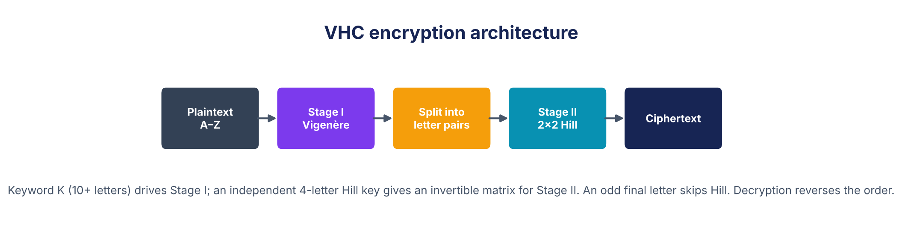
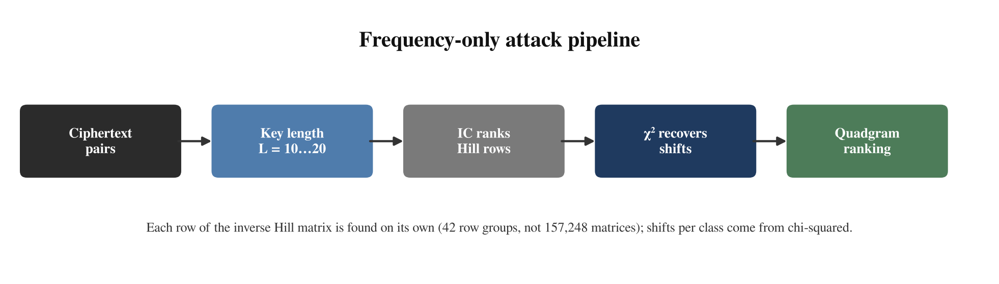
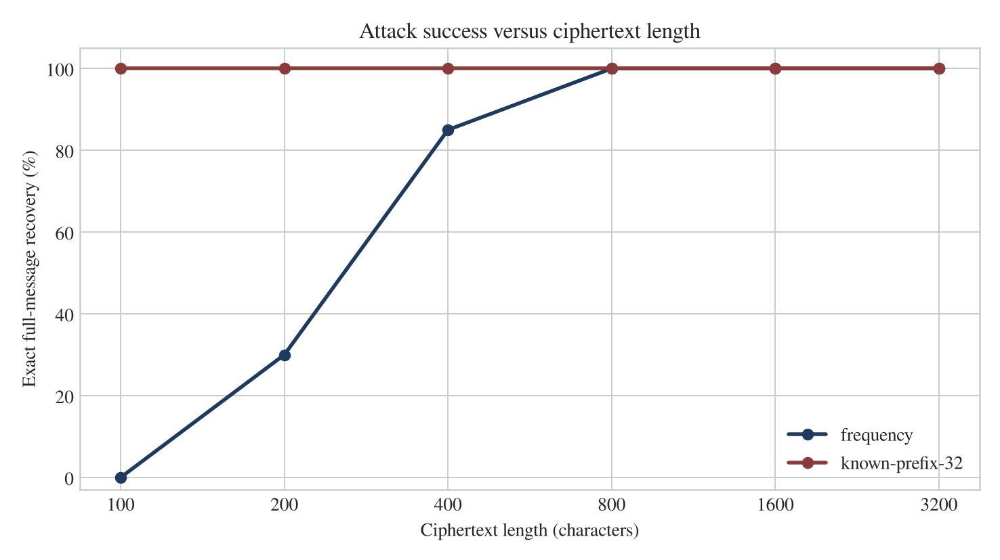
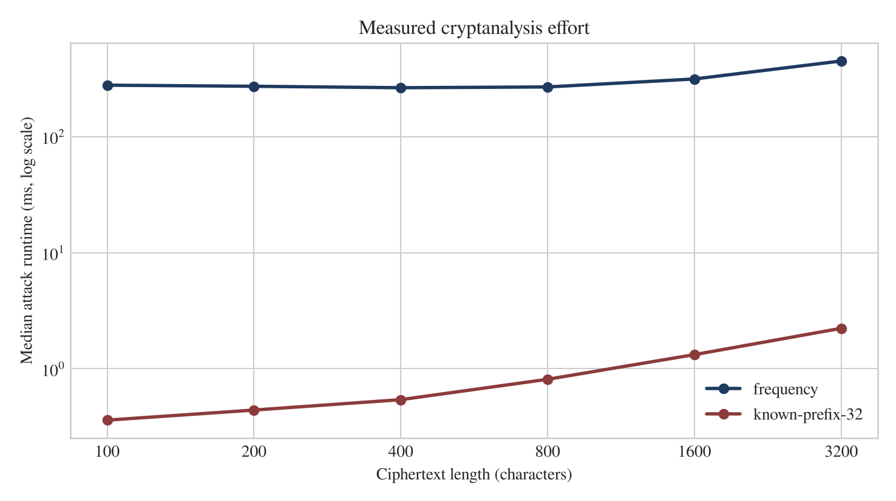
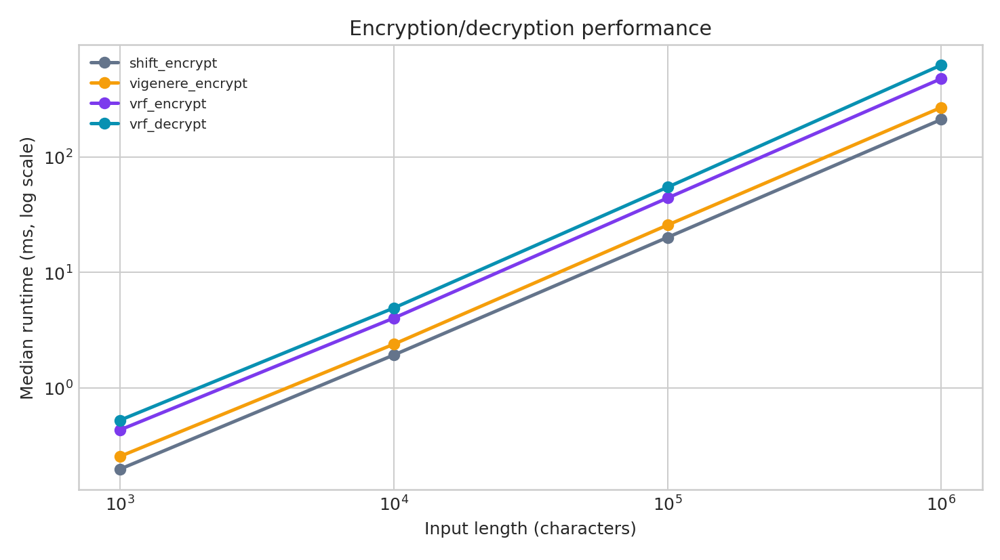

# Executive summary

This project presents **VRFC (Vigenère–Rail-Fence Cascade)**, a two-stage classical product cipher. Stage I applies a repeating-key Vigenère substitution; Stage II permutes the substituted text with a Rail-Fence transposition. A single validated alphabetic key of at least 10 characters controls both stages. The reference example uses the 12-letter key `CRYPTOGRAPHY`, for which the key schedule selects seven rails.

The submission includes a standard-library Python implementation, exact decryption, automated tests, a ciphertext-only statistical attack, and a partial-known-plaintext attack. The statistical attack enumerates the small rail space, uses the index of coincidence (IC) to shortlist key lengths, recovers each Vigenère shift with chi-squared frequency analysis, and ranks complete candidates with an English quadgram model. The known-plaintext attack derives the repeating key stream directly from a known prefix and then decrypts the full message.

All reported measurements are outputs of the included reproducible experiment, not estimated values. Across 20 independent trials per length, the frequency-only attack achieved exact full-message recovery in **0% of 100-character cases, 35% at 200 characters, 95% at 400 characters, and 100% at 800, 1,600, and 3,200 characters**. With a 24-character known prefix, exact recovery was **100% at every tested length**. These results demonstrate that adding a transposition stage increases implementation and attack cost but does not make a repeating-key classical cipher secure.

> Security scope: VRFC is an educational construction for classical cryptanalysis. It must not be used to protect real credentials, patient data, financial information, or production communications.

# 1. Introduction and objectives

Classical ciphers are useful teaching systems because their operations are transparent and their weaknesses can be measured directly. A substitution cipher changes symbols, whereas a transposition cipher changes symbol positions. Combining the two produces a small **product cipher**: the output of one classical transformation becomes the input to another.

The objective is not merely to produce unreadable text. A complete design must also be reversible, testable, and breakable under an explicit attacker model. Accordingly, this project has four technical objectives:

- implement a correct two-stage cipher for arbitrary-length A–Z messages;
- use a validated encryption key of at least 10 characters;
- demonstrate both statistical and known-plaintext cryptanalysis with measured outcomes; and
- quantify asymptotic and practical cost relative to a single Shift cipher.

The work follows Kerckhoffs's principle: the attacker knows the algorithm, implementation, and configured search bounds; only the encryption key and plaintext are secret [4]. This is a stronger and more realistic assumption than relying on concealment of the algorithm.

# 2. Cipher design

## 2.1 Notation and data domain

| Symbol | Meaning |
|---|---|
| P | Normalized plaintext, P ∈ {A,…,Z}ⁿ |
| C | Final ciphertext, C ∈ {A,…,Z}ⁿ |
| K | Alphabetic key of length L ≥ 10 |
| kᵢ | Numeric shift of key letter i, in 0…25 |
| T | Intermediate Vigenère ciphertext |
| r | Rail count, derived in the range 2…8 |
| n | Number of normalized characters |

Input is uppercased and every non-ASCII-A–Z character is removed. Thus `Meet at 6 PM!` becomes `MEETATPM`. This convention makes the alphabet, indexing, and frequency model unambiguous. Decryption recovers the exact **normalized** plaintext; spaces and punctuation are intentionally outside the cipher domain. Empty strings, one-character messages, partial zigzag cycles, and long inputs are supported without padding.

## 2.2 Stage I — Vigenère substitution

For plaintext position i and key length L, Stage I computes:

> Tᵢ = (Pᵢ + kᵢ mod L) mod 26

The inverse operation is:

> Pᵢ = (Tᵢ − kᵢ mod L) mod 26

A repeating keyword makes this polyalphabetic: the same plaintext letter can map to different ciphertext letters at different positions. Unlike a single Shift cipher, however, the repeated key creates periodic structure that an attacker can exploit [1], [2].

## 2.3 Key-derived Stage II parameter

The implementation derives the rail count rather than introducing a second independent secret:

> r = 2 + [Σ(i + 1)(Kᵢ − 64)] mod 7, for zero-based i

Because Kᵢ − 64 maps A…Z to 1…26, the result lies in 2…8. This schedule is deterministic, so sender and receiver always select the same rail count. It also creates a deliberate teaching trade-off: the key affects both stages, but the effective transposition search space contains only seven possibilities.

## 2.4 Stage II — Rail-Fence transposition

Stage II writes T along a zigzag path over r rails and reads the characters rail by rail. For r ≥ 2, the path period is 2r − 2. At position i, let j = i mod (2r − 2); the selected rail is j when j < r and 2r − 2 − j otherwise. Transposition changes positions but not the underlying character multiset.



The final construction is:

> C = RailFenceᵣ(Vigenèreₖ(P))

Decryption must invert the stages in reverse order:

> P = Vigenèreₖ⁻¹(RailFenceᵣ⁻¹(C))

# 3. Algorithms and correctness

## 3.1 Encryption algorithm

```text
ALGORITHM VRFC-Encrypt(P, K)
1  P ← uppercase A-Z letters of P; K ← uppercase A-Z letters of K
2  require |K| ≥ 10
3  r ← DeriveRails(K)                         // integer in [2, 8]
4  for i ← 0 to |P| − 1:
5      T[i] ← (P[i] + K[i mod |K|]) mod 26
6  determine the zigzag rail of every position i using period 2r − 2
7  append each T[i] to its selected rail
8  C ← concatenation of rail 0, rail 1, …, rail r − 1
9  return C
```

## 3.2 Decryption algorithm

```text
ALGORITHM VRFC-Decrypt(C, K)
1  C ← uppercase A-Z letters of C; K ← uppercase A-Z letters of K
2  require |K| ≥ 10
3  r ← DeriveRails(K)
4  regenerate the zigzag indices for |C| characters
5  count the positions assigned to each rail
6  split C into rail strings using those counts
7  T ← characters read back in the original zigzag order
8  for i ← 0 to |T| − 1:
9      P[i] ← (T[i] − K[i mod |K|]) mod 26
10 return P
```

## 3.3 Why decryption is exact

The zigzag index function is deterministic for a fixed n and r. Counting its rail assignments gives the exact length of every serialized rail, so Step 6 partitions C without ambiguity. Reading those segments in the original index order restores T exactly. Modular subtraction then reverses each modular addition. Therefore `Decrypt(Encrypt(P, K), K) = P` for every normalized P and every valid K. The automated suite checks this property for empty, boundary-length, and multi-cycle messages, for all rail counts from two through eight.

# 4. Worked example

The example uses the normalized plaintext `MEETATTHELIBRARYATSIXPM` and 12-character key `CRYPTOGRAPHY`.

| Step | Value |
|---|---|
| Plaintext P | MEETATTHELIBRARYATSIXPM |
| Key K | CRYPTOGRAPHY |
| Derived rails r | 7 |
| Stage I output T | OVCITHZYEAPZTRPNTHYZXET |
| Final ciphertext C | OTVZRCPPTIANETETXHYHZZY |
| Decrypted output | MEETATTHELIBRARYATSIXPM |

The seven serialized Rail-Fence rows are:

| Rail | Characters read from Stage I |
|---|---|
| 1 | OT |
| 2 | VZR |
| 3 | CPPT |
| 4 | IANE |
| 5 | TETX |
| 6 | HYHZ |
| 7 | ZY |

Concatenating the rows produces `OT` + `VZR` + `CPPT` + `IANE` + `TETX` + `HYHZ` + `ZY` = `OTVZRCPPTIANETETXHYHZZY`. This small example also explains why a wrong rail count changes row boundaries and prevents correct recovery of T.

# 5. Reference implementation

**Source repository:** https://github.com/HamzaSaleem56/NIS_CCP (public).

The solution is implemented in Python 3 with no third-party runtime dependency for encryption, decryption, or cryptanalysis. Matplotlib is used only to regenerate report charts.

| File | Responsibility |
|---|---|
| `src/cipher.py` | Normalization, key validation, both stages, VRFC, Shift baseline, CLI |
| `src/attack.py` | IC, chi-squared, quadgram model, frequency and known-prefix attacks |
| `src/experiment.py` | Seeded trials, raw CSV output, summaries, benchmarks, charts |
| `tests/test_cipher.py` | Standard vector, inverse properties, boundary cases, attack recovery |
| `data/` | Separate training and evaluation language corpora with attribution |
| `results/` | Actual measurements, metadata, and generated figures |

Representative commands are:

```bash
python3 src/cipher.py encrypt --key CRYPTOGRAPHY --text "MEET AT THE LIBRARY AT SIX PM"
python3 src/cipher.py decrypt --key CRYPTOGRAPHY --text OTVZRCPPTIANETETXHYHZZY
python3 src/attack.py frequency --cipher-file ciphertext.txt
python3 src/attack.py known --known-prefix MEETATTHELIBRARYATSIXPM --cipher-file ciphertext.txt
python3 -m unittest discover -s tests -v
python3 src/experiment.py --trials 20 --seed 20261108
```

# 6. Attack methodology

## 6.1 Attacker knowledge and success criterion

Two attacker models are evaluated separately. The **ciphertext-only** attacker has C, the public algorithm, the rail range 2…8, a maximum key length of 20, and general English statistics. The **known-prefix** attacker additionally has the first m normalized plaintext characters. Neither attacker receives K or r.

An attempt counts as successful only when the entire recovered normalized plaintext exactly equals the original. Partial or readable guesses are not counted as exact successes. Mean letter accuracy is reported separately to expose near-misses.

## 6.2 Frequency-only attack

### Step A: enumerate transposition candidates

For every r ∈ {2,…,8}, invert Rail Fence on C. This produces seven candidate Stage I strings T⁽ʳ⁾. Exactly one uses the correct transposition; the other six normally have scrambled character order.

### Step B: rank key lengths with index of coincidence

For a candidate key length L, split T into L interleaved columns. At the correct length, each column is a single Shift cipher and retains approximately English-like coincidence. At many incorrect lengths, shifts mix and the value approaches the uniform baseline. IC is computed as [2]:

> IC = [Σ fₐ(fₐ − 1)] / [n(n − 1)]

The implementation ranks L = 1…20 by closeness to English IC ≈ 0.066 and evaluates the best eight lengths per rail. It does not assume that IC alone is conclusive, especially for short inputs.

### Step C: recover shifts by chi-squared frequency analysis

For each key position, all 26 shifts are tested. Observed letter counts Oₐ are compared with expected English counts Eₐ:

> χ² = Σ (Oₐ − Eₐ)² / Eₐ

The shift with minimum χ² becomes that key character. This is ordinary frequency analysis applied independently to each Vigenère column [2].

### Step D: rerank full decryptions with quadgrams

Chi-squared works on isolated columns and can make mistakes when a column contains few letters. A character-quadgram model therefore scores every complete candidate in reading order. The model is trained on 600,000 letters from *Pride and Prejudice* and *The Adventures of Sherlock Holmes*. Add-k smoothing assigns a finite penalty to unseen quadgrams. Evaluation uses a different work, *A Tale of Two Cities*, reducing training/test leakage [6]–[8].



With seven rail counts and eight shortlisted key lengths, each attempt evaluates 56 complete candidates. The highest-scoring candidate is returned.

## 6.3 Partial-known-plaintext attack

Let the attacker know P₀…Pₘ₋₁ and the complete C. For each candidate rail count:

1. Undo Rail Fence to obtain T.
2. Derive the first m key-stream symbols: Sᵢ = (Tᵢ − Pᵢ) mod 26.
3. For each L = 10…min(20, m), test whether Sᵢ = Sᵢ mod L for all known positions.
4. Use the first L stream symbols as K and decrypt the complete T.
5. Score every algebraically consistent full decryption with the quadgram model and select the highest-scoring candidate. This ranking is a heuristic selection step, not independent proof of correctness.

When m ≥ L, every key position is observable, so a compatible candidate key and full-message candidate can be constructed. When m > L, periodicity adds independent constraints that reject wrong candidates. At the boundary m = L, the periodicity test adds no constraint beyond the known prefix, so the language model must choose among rail candidates. Recovery is therefore experimental and heuristic rather than a uniqueness guarantee. A prefix shorter than L does not expose every key letter. The key-stream derivation itself is algebraic rather than a brute-force search over 26ᴸ keys.

# 7. Experimental method

The experiment is deterministic under seed `20261108` and uses 20 trials per configuration. Trial messages are sampled from the separate evaluation corpus, and ten different keys of lengths 10, 11, and 12 are rotated. Frequency attacks are run at six ciphertext lengths: 100, 200, 400, 800, 1,600, and 3,200 characters. The known-prefix attack is tested at the same lengths with m = 24; a second experiment varies m over 12, 24, 48, and 96 for 1,600-character messages.

Runtime is measured with `time.perf_counter()` and excludes one-time corpus loading. Encryption benchmarks use 21 repetitions through 100,000 characters and seven at one million characters; medians are emphasized to reduce outlier influence. Exact-success uncertainty is summarized with 95% Wilson score intervals, which are more informative than treating 20 trials as a universal probability.

The measurement environment was Python 3.12.3 on Linux/WSL2, x86-64, with an Intel Core i7-9850H processor (12 logical CPUs). All code was single-threaded. Timings describe this environment only; success percentages describe this corpus, key set, and configured search bounds rather than every possible natural-language message.

# 8. Attack results and interpretation

## 8.1 Frequency-only attack

{{FREQUENCY_TABLE}}



The trend has a clear statistical explanation. At 100 characters, a 12-letter key leaves only about eight observations per key column, so IC and chi-squared estimates are unstable. The attack recovered no complete message at that length, although its mean letter accuracy was 63.15%, showing that several attempts were partially correct. At 200 characters, exact recovery rose to 35%; at 400 it reached 95%. From 800 characters onward, every trial in this experiment recovered the exact message.

This is not a claim of guaranteed success above 800 characters. The 95% Wilson interval for 20/20 successes is 83.89%–100%, and atypical or very short documents, non-English text, and keys outside the tested bounds can reduce performance. The honest conclusion is narrower and more useful: **ordinary long English messages provide enough repeated-key statistical leakage for this implementation to become highly reliable**.

## 8.2 Known-prefix attack

{{KNOWN_TABLE}}

Every 24-prefix configuration achieved exact recovery. Runtime grows with message length because each final candidate must be decrypted and scored, but it remains far below the statistical attack. The small mean candidate count also shows why periodic key-stream consistency is such a strong filter.

{{PREFIX_TABLE}}

Even a 12-letter prefix sufficed for all keys in this experiment because the longest key was 12 letters. At this m = L boundary, recovery relied on language-model ranking rather than unique algebraic elimination. Longer prefixes add redundancy: wrong rail/key-length combinations become less likely to satisfy the periodicity equations. This explains the decrease in mean candidates after the 12-prefix case.



# 9. Security analysis

## 9.1 Where the design helps

The Vigenère stage removes the trivial 25-key search of a single Shift cipher. A naive 12-letter alphabetic key has 26¹² nominal possibilities, and the Rail-Fence stage disrupts reading order before a conventional Vigenère attack can be applied. Two stages also increase code, execution time, and the number of candidate transformations an attacker must examine.

These properties are meaningful educationally: the cascade separates confusion-like symbol replacement from diffusion-like position rearrangement and shows why a product cipher must be analyzed as a complete system.

## 9.2 Why the design still fails

**Small effective transposition space.** Only seven rail counts exist. Enumerating them is inexpensive, so Stage II adds a small constant factor rather than exponential difficulty.

**Repeated-key leakage survives the cascade.** Once the correct rail candidate is inverted, the Vigenère periodicity is restored. IC, chi-squared, and language statistics can then recover the key without trying all 26ᴸ possibilities.

**Known plaintext is catastrophic.** A known prefix of at least one key length exposes every residue of the repeated key stream. The full ciphertext can then be decrypted, regardless of total message length.

**Key schedule coupling.** Deriving r from K does not add an independent secret. It is convenient and satisfies the two-stage design goal, but a separate transposition key would force more independent recovery work.

**No modern security properties.** There is no cryptographic random nonce, no nonlinear modern S-box, no authenticated integrity, and no protection against active modification. Classical letter statistics and small structural spaces remain visible to software.

The measured results therefore support a central cryptologic lesson: **combining two weak operations does not automatically produce a strong operation**. Security must be evaluated against concrete attacks, not visual ciphertext randomness or nominal key length alone.

# 10. Complexity and efficiency

## 10.1 Asymptotic analysis

Let n be message length, L the actual key length, M the maximum candidate key length, R the number of rail candidates, Q the shortlisted key lengths, and A = 26 the alphabet size.

| Operation | Time | Auxiliary space | Reason |
|---|---|---|---|
| Vigenère encrypt/decrypt | O(n) | O(n) | One modular operation per character; output retained |
| Rail-Fence encrypt/decrypt | O(n) | O(n) | One index calculation and one move per character |
| VRFC encrypt/decrypt | O(n) | O(n) | Two sequential linear stages |
| Shift encrypt/decrypt | O(n) | O(n) | One linear substitution pass |
| Frequency attack | O(RMn + RQ·26n + RQn) = O(Rn(M + 26Q)) | O(n + corpus model) | IC ranks M lengths; chi-squared and final scoring process Q lengths |
| Known-prefix attack | O(Rn + RMm + RNn) | O(n) | Rail inversion, periodicity tests, and N surviving full decryptions |

For fixed M = 20, R = 7, and Q = 8, the frequency attack is linear in n with a large constant. If the bounds grow, the IC stage grows with R and M, while the more expensive shift-recovery/scoring stages grow with R and Q. The known-prefix expression uses N for surviving candidates; in the experiments, periodicity filtering made N small.

## 10.2 Measured encryption and decryption performance

{{PERFORMANCE_TABLE}}



{{PERFORMANCE_ANALYSIS}} This is consistent with the two-stage design: the asymptotic class remains O(n), but the constant work and memory traffic increase. Smaller inputs show more interpreter and setup overhead, so ratios should not be treated as fixed hardware-independent constants. Some adjacent measurements are non-monotonic because of normal scheduling and cache noise; using medians reduces, but does not eliminate, that variability.

The frequency attack is much more expensive than encryption because it performs dozens of statistical candidate decryptions. Known-plaintext recovery is cheaper because algebraic periodicity checks eliminate almost all candidates before full decryption.

# 11. Improvements without major complexity growth

| Improvement | Security effect | Cost and residual limitation |
|---|---|---|
| Use independent, longer Vigenère and transposition keys | Removes key-schedule coupling and increases independent unknowns | Same asymptotic cost; repeating substitution remains statistically weak |
| Replace Rail Fence with keyed columnar transposition | A keyword-defined permutation has a much larger practical search space than seven rails | Still linear per message; vulnerable to anagramming and known structure |
| Add a second substitution–transposition round with independent keys | Forces more candidate combinations and reduces direct single-round alignment | Roughly doubles work; repeating keys and known plaintext remain dangerous |
| Use an autokey/running-key variant instead of simple repetition | Reduces periodic IC evidence and makes key-length estimation harder | More state and careful synchronization; plaintext feedback can introduce other weaknesses |
| Increase statistical-language diversity and avoid known formatted headers | Reduces predictable cribs and makes one fixed English model less reliable | Operational restriction, not a cryptographic proof; does not repair the cipher |

These changes can raise attack effort for a classroom exercise, but none should be represented as production-grade security. For real confidentiality and integrity, the correct engineering decision is to replace the construction with a reviewed authenticated-encryption scheme such as AES-GCM or ChaCha20-Poly1305, using a maintained library, unique nonces, and proper key management.

# 12. Limitations and validity threats

- Twenty trials per configuration provide useful comparative evidence but not exact population probabilities; Wilson intervals are included for that reason.
- Minimum key length is not minimum key entropy. Repetitive keys such as `AAAAAAAAAA` or `ABABABABAB` pass length validation but have a much shorter effective period; strong keys should be long and non-repetitive.
- A statistically equivalent repeated-period key can occasionally be returned instead of the original key text. Exact plaintext recovery is therefore the primary success criterion; exact original-key recovery is recorded separately.
- The language model and plaintexts are English. Other languages, compressed data, random strings, or highly technical text can change frequency-attack success.
- The tested keys contain 10–12 letters and the attacker searches lengths through 20. Longer keys require more ciphertext per column and more computation. The frequency attack also tests shorter effective periods because a divisor of the true period can decrypt correctly.
- IC retains only eight shortlisted lengths per rail. This bounds cost but can exclude the true period on short or noisy ciphertext, so the shortlist is a recall limitation rather than a proof that other lengths are impossible.
- Rail counts are intentionally bounded to 2…8 by the design. Extending that bound increases attack work linearly but does not eliminate the structural flaw.
- Exact recovery is strict and may understate partial cryptanalytic progress; mean letter accuracy is therefore included.
- Runtime measurements are single-machine and single-threaded. They should be compared within this experiment, not treated as universal benchmarks.

# 13. Conclusion

VRFC satisfies the assignment's two-stage classical-design requirement with a reversible Vigenère substitution and Rail-Fence transposition, a validated key of at least 10 characters, arbitrary-length A–Z handling, and a complete Python implementation. The project also demonstrates that correct encryption is only half of cipher design: explicit attacks expose whether the construction meaningfully resists analysis.

The frequency attack became reliable as more ciphertext supplied statistical evidence, while a one-key-length known prefix was sufficient to recover the complete message in the tested configurations. Both encryption and decryption remain O(n), with roughly twice the measured large-message cost of a Shift baseline. The strongest conclusion is therefore not that the cascade is secure, but that its exact weakness can be explained, implemented, measured, and reproduced.

# References

[1] W. Stallings, *Cryptography and Network Security: Principles and Practice*, 8th ed. Pearson, 2020. Classical substitution, transposition, and cryptanalysis foundations.

[2] D. Mukhopadhyay, “Cryptanalysis,” IIT Kharagpur cryptography course slides. Vigenère cryptanalysis, Kasiski examination, and index of coincidence. https://cse.iitkgp.ac.in/~debdeep/courses_iitkgp/Crypto/slides/cryptanalysis.pdf (accessed 2 November 2026).

[3] Alagappa University, *Cryptography and Network Security* course material, Section 3.5. Rail-Fence and columnar transposition explanations. https://mis.alagappauniversity.ac.in/siteAdmin/dde-admin/uploads/3/PG_M.Sc._Computer%20Science_34131%20CRYPTOGRAPHY%20AND%20NETWORK%20SECUTRITY.pdf (accessed 2 November 2026).

[4] EPFL Graph Search, “Auguste Kerckhoffs.” Summary of Kerckhoffs's design principles and key-secrecy principle. https://graphsearch.epfl.ch/en/concept/240985 (accessed 2 November 2026).

[5] C. Corning, “Cryptanalysis of the Vigenère's Cipher,” Georgia Southern University Research Symposium, 2014. https://digitalcommons.georgiasouthern.edu/gurc/2014/2014/78/ (accessed 2 November 2026).

[6] J. Austen, *Pride and Prejudice*. Project Gutenberg eBook 1342. https://www.gutenberg.org/ebooks/1342 (training corpus; accessed 2 November 2026).

[7] A. C. Doyle, *The Adventures of Sherlock Holmes*. Project Gutenberg eBook 1661. https://www.gutenberg.org/ebooks/1661 (training corpus; accessed 2 November 2026).

[8] C. Dickens, *A Tale of Two Cities*. Project Gutenberg eBook 98. https://www.gutenberg.org/ebooks/98 (separate evaluation corpus; accessed 2 November 2026).

# Appendix A — Requirement compliance matrix

| Required item | Delivered evidence |
|---|---|
| Two classical techniques and two stages | Vigenère substitution + Rail-Fence transposition; Sections 2–4 |
| Key length ≥ 10 | Validation rejects shorter keys; experiments use 10–12 letter keys |
| Encryption and decryption program | `src/cipher.py`, CLI, mathematical and pseudocode inverses |
| A–Z and variable input lengths | Normalization contract and boundary/round-trip tests |
| Frequency-analysis attack | `src/attack.py`: rail enumeration, IC, chi-squared, quadgram ranking |
| Known-plaintext attack | Partial-prefix key-stream recovery and full-message decryption |
| Success rates at several lengths | Six lengths, 20 trials each, raw CSV and Wilson intervals |
| Computational effort | Median/mean attack times and candidate counts |
| Encryption/decryption complexity | Section 10 asymptotic table |
| Shift-cipher comparison | Measured baselines at four input sizes and Figure 5 |
| Security improvements | Section 11 with cost and residual-risk analysis |
| GitHub repository | Public repository at https://github.com/HamzaSaleem56/NIS_CCP; organized source, tests, data attribution, raw results, README |

# Appendix B — Verification and reproducibility

The automated suite completed **8/8 tests successfully**. It includes the standard Vigenère `ATTACKATDAWN`/`LEMON` vector, Rail-Fence inverses for every rail count and lengths 0–79, custom-cipher round trips for multiple keys and boundary lengths, key validation, Shift baseline behavior, and end-to-end known-prefix plus frequency-only recoveries.

To reproduce the report's measurements from the project root:

```bash
python3 -m unittest discover -s tests -v
python3 src/experiment.py --trials 20 --seed 20261108
python3 src/build_report.py
```

The raw per-trial rows are supplied in `results/frequency_attack_raw.csv`, `results/known_plaintext_raw.csv`, and `results/known_prefix_lengths.csv`. Aggregate values are in `results/attack_summary.csv`; benchmark samples are summarized in `results/performance.csv`. `results/experiment_metadata.json` records the seed, bounds, and worked example. This separation allows every reported percentage to be audited rather than trusted as a handwritten claim.
